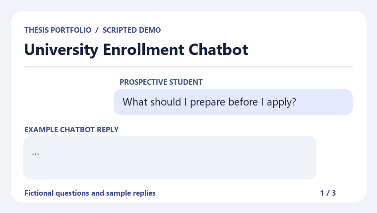

# University Enrollment Chatbot

A team thesis project that explored how a chatbot could help prospective students find answers to common enrollment questions.

The demo is a scripted walkthrough with fictional questions and sample replies. The replies are examples for the portfolio and do not represent any university's enrollment policy.

## Example conversations

| Student asks | Example reply |
| --- | --- |
| What should I prepare before I apply? | Start with the application form and your latest school records. Check the admissions checklist for your program. |
| When is the application deadline? | Deadlines vary by program and intake. Check the admissions calendar for the term you plan to apply for. |
| Who can help if I get stuck? | Contact the admissions office and tell them which program you're applying to and where you need help. |

## My contribution

I helped set up the chatbot as part of our thesis team. The project was a collaboration with my fellow computer science students at Saint Louis University.
